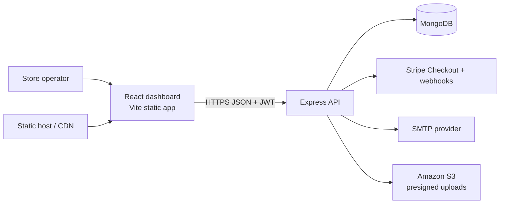

# Architecture and Workflows

## System overview

The client and API are independently deployable. The dashboard opens with representative demo data, then staff/admin sign-in loads live summary, order, product, and customer data through protected API routes. Channel allocation, activity, and best-seller widgets remain sample content. Production user and operational records must only be read through authenticated API routes.

## Database schema

### `users`

- `name`, unique normalized `email`, selected-out `passwordHash`, and `role` (`customer`, `staff`, `admin`)
- Mongoose timestamps provide `createdAt` and `updatedAt`
- Public registration always assigns `customer`; privilege is granted through an operator-controlled provisioning step

### `products`

- `name`, `description`, unique uppercase `sku`, `category`, numeric `price`, integer `inventory`, `imageUrl`, and `active`
- Text index on name, description, and category; archived products are hidden from the public catalog

### `orders`

- Unique `orderNumber`, customer reference, immutable-at-checkout item snapshots (product reference, name, quantity, unit price), `subtotal`, `currency`, `status`, Stripe session ID, and `paidAt`
- Status values: `pending`, `processing`, `paid`, `shipped`, `refunded`, `cancelled`
- Indexes on customer, status, and creation date support customer history, operations queues, and reporting

Amounts are stored as numeric major currency units in MongoDB and converted to integer cents for Stripe. The API currently supports USD checkout. For multi-currency accounting, use integer minor units and explicit currency exponent handling.

## Authentication and authorization

Passwords are hashed with bcrypt (12 rounds). Signed JWTs expire after eight hours. Auth endpoints are rate limited; Helmet, bounded JSON request bodies, CORS allowlisting, Zod validation, and role middleware protect the API surface. Customers can view only their own orders. Staff/admin can manage catalog and fulfillment and view customer and analytics data. No public endpoint accepts a role value.

For production, provision the first administrator through a controlled operator process, rotate JWT secrets, use HTTPS, restrict database and S3 network/IAM access, and centralize audit logs and secrets management. Add MFA and audited administrative actions before using this as a regulated commerce system.

## Workflows

### Checkout

1. An authenticated customer submits product IDs, quantities, and success/cancel URLs.
2. The API reloads active products and checks current inventory and prices; client prices are never trusted.
3. A pending order snapshots item names and prices, then the API creates a Stripe Checkout Session and stores its ID.
4. Stripe sends signed webhooks. An order is marked paid only after a verified session reports paid (or an async payment succeeds); expired and failed async sessions cancel a pending order.

Inventory is checked at checkout but not reserved or decremented transactionally. Before production traffic, add an inventory reservation/expiry strategy and an idempotent webhook event ledger to prevent overselling and duplicate event processing.

### Product image upload

1. A staff/admin requests an upload URL with a supported MIME type.
2. The API creates an unpredictable object key and returns a presigned S3 PUT URL valid for five minutes.
3. The client uploads directly to S3. When `ASSETS_BASE_URL` is configured, the API also returns the CDN object URL to store on the product. Configure bucket CORS, encryption, lifecycle, and a CDN/public-read strategy appropriate to the deployment.

### Order notifications

Authorized staff can request a customer status email through the SMTP adapter. Delivery is synchronous in this starter; use a durable queue with retries and idempotency for production volumes.

## Scalability and operations

The API is stateless and can run behind a TLS-terminating load balancer. MongoDB, S3, and Stripe hold shared external state. Analytics currently aggregate the previous 30 days from orders; at higher volume, use pre-aggregated daily metrics, bounded timeouts, and read replicas. Add request tracing, structured logging, alerting, backup/restore drills, and rate limits calibrated to traffic before production launch.
